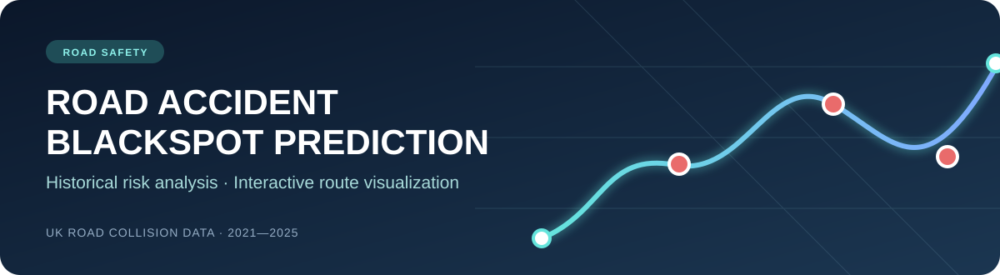
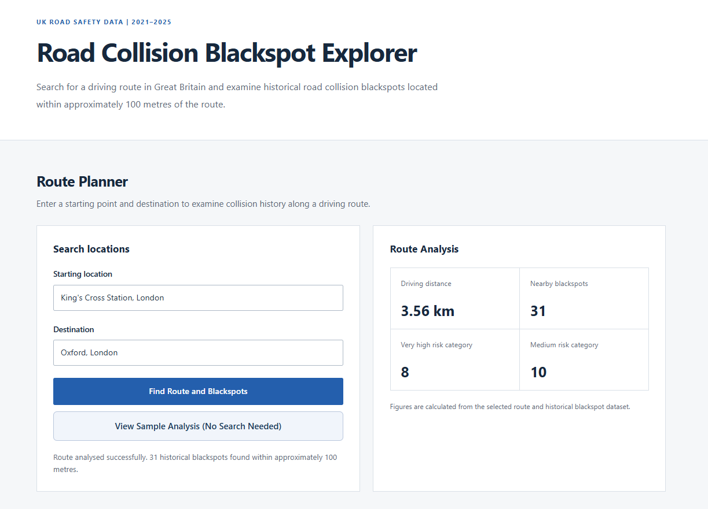
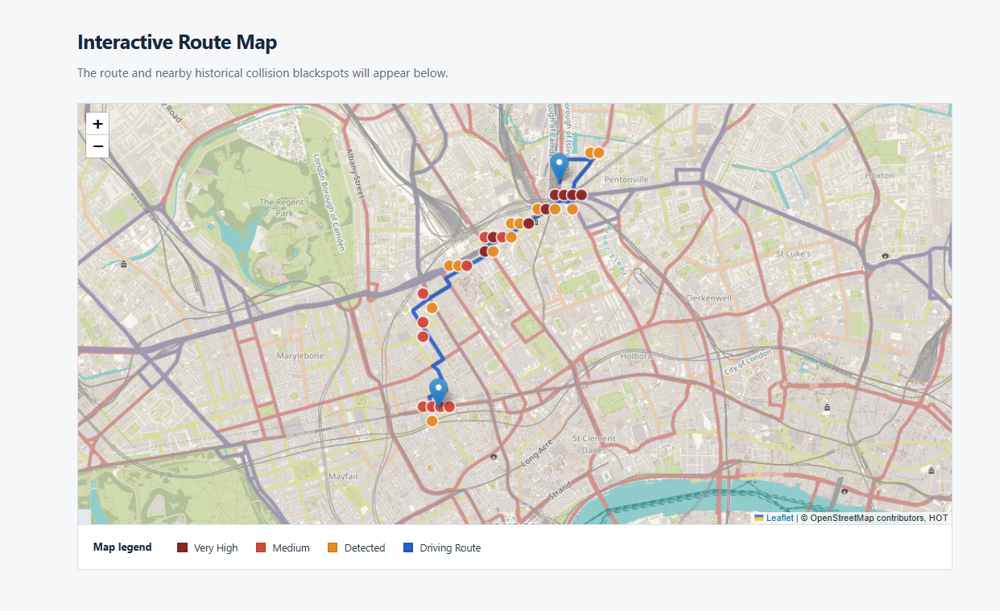
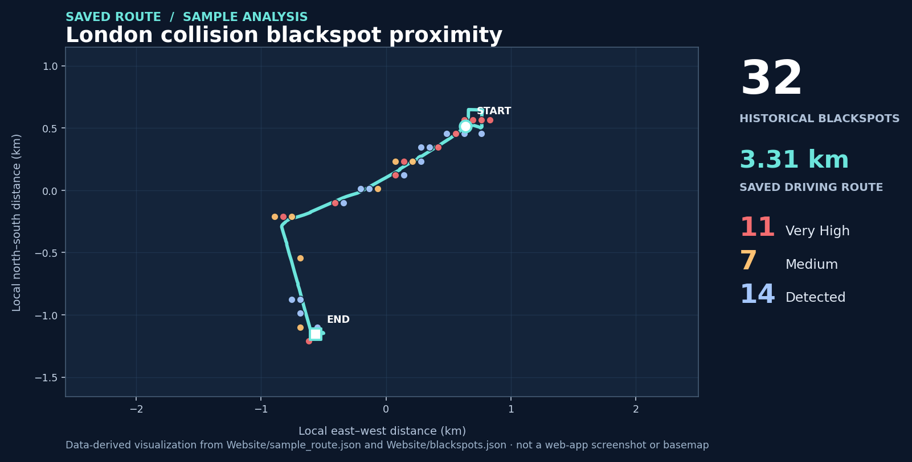
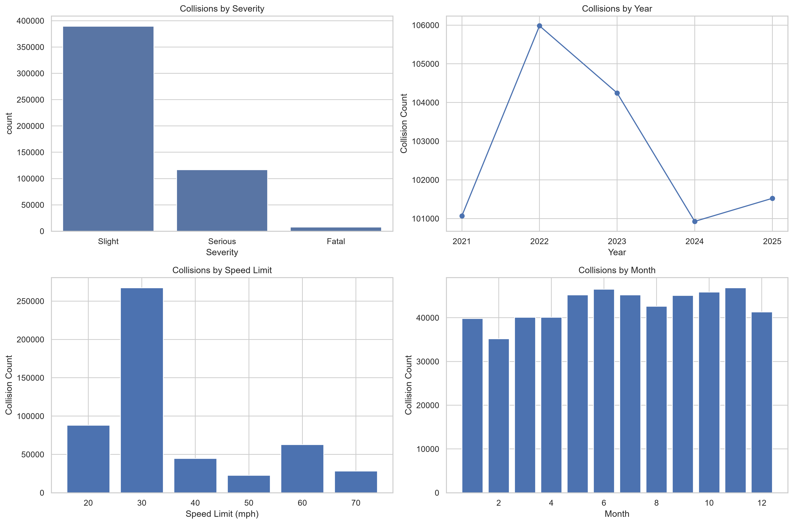
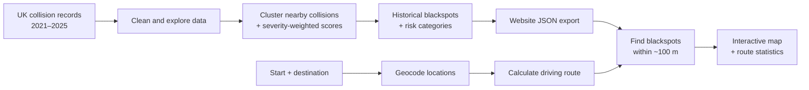

<div align="center">



<br/>

**Turning historical collision records into route-level road safety insights.**

[](https://dhejasvibaskar.github.io/Road-Accident-Blackspot-Prediction/)
[](https://github.com/Dhejasvibaskar/Road-Accident-Blackspot-Prediction)
[](#tech-stack)

*Principles of Data Science • UK road collisions • Historical blackspot detection*

</div>

---

## 🚦 The idea

**Which parts of a driving route have a history of concentrated road collisions?**

This project studies UK Department for Transport collision records from **2021–2025** to identify historical accident blackspots, evaluate how well earlier blackspots align with later collisions, and visualize potentially relevant blackspots along a chosen driving route.

The web demo lets visitors enter two locations in Great Britain—or open a saved sample analysis—to see a route, nearby blackspots, and severity-based categories.

> [!IMPORTANT]
> **What the website does:** It overlays *precomputed historical blackspots* near a route. It does **not** predict a particular driver's future accident risk or run live model inference in the browser. Risk labels are **project-defined**, not official road safety classifications.

## ✨ Explore the live demo

<p align="center">
  <a href="https://dhejasvibaskar.github.io/Road-Accident-Blackspot-Prediction/"><strong>▶ Open Road Collision Explorer</strong></a>
</p>

| 🧭 Route search | 📍 Historical hotspots | 📊 Route insights | ⚡ Sample demo |
|:--|:--|:--|:--|
| Start + destination in Great Britain | Spots within ~100 m of the route | Distance, counts and project risk categories | View a saved London route without live geocoding |

## 🖥️ Product walkthrough

Two **real screenshots from the deployed website**, captured after analyzing a London route. Click each image to view it at full resolution.

### 01 · Search a route. See its safety history.

Choose a start and destination to calculate the driving route and examine the historic blackspots found near it. Alternatively, **View Sample Analysis** opens an example instantly, without manual search.

<p align="center">
  <a href="assets/screenshots/01-route-planner.png">
    
  </a>
</p>

<p align="center"><sub>Actual website screenshot · Example route: King's Cross Station → Oxford, London · 3.56 km · 31 nearby historical blackspots</sub></p>

### 02 · Explore the blackspots on an interactive map.

Inspect the road route and colored markers for nearby historical collision blackspots. The map legend distinguishes **Very High**, **Medium**, and other detected spots; it also shows the **driving route**.

<p align="center">
  <a href="assets/screenshots/02-interactive-route-map.png">
    
  </a>
</p>

<p align="center"><sub>Actual website screenshot · Leaflet map with route and historical collision markers</sub></p>

<details>
<summary><strong>📍 Want to see a marker up close?</strong></summary>

Open the [live demo](https://dhejasvibaskar.github.io/Road-Accident-Blackspot-Prediction/) and click a colored marker to inspect its available details. A close-up screenshot can be added here later.

<!-- Optional: after capturing a real marker popup, add the image file and uncomment this line.

-->

</details>

## 📊 Behind the map: data science visuals

### 03 · Reproducible saved-route visualization

The figure below is **generated directly from the project's saved route and blackspot JSON files**. It is an analysis graphic, not a screenshot of the live street map; its sample dataset may differ from the route illustrated above.



### 04 · Collision data exploration

The following figure comes from the project's saved EDA output.



## 🧠 How it works



**Project workflow**

1. **Prepare the data:** clean and explore UK collision records, including collision severity and location fields.
2. **Detect hotspots:** group nearby historical collisions, compute collision-frequency and severity-based scores, and assign project risk categories.
3. **Evaluate historical coverage:** derive blackspots from **2021–2024** records and measure proximity coverage against held-out **2025** collisions.
4. **Visualize routes:** use location search and road routing to find precomputed blackspots roughly **100 metres** from the route.
5. **Make results accessible:** display the saved dataset through a static, deployable website with a one-click sample route.

## 📈 Evaluation snapshot

The saved evaluation output (included here as `assets/readme/prediction_evaluation_summary.csv`) reports:

| Metric | Result |
|:--|--:|
| Training-period collision records (2021–2024) | **412,225** |
| Test-period collision records (2025) | **101,523** |
| Blackspots identified from training period | **9,639** |
| 2025 collisions within 100 m of those blackspots | **18,471** |
| Historical blackspot coverage at 100 m | **18.19%** |
| Random-location baseline coverage at 100 m | **4.91%** |
| Improvement over baseline | **+13.28 percentage points** |

**Interpretation:** Historical hotspot locations covered more held-out 2025 collision locations than the random-location baseline under the project's 100-metre proximity measure. This is **coverage**, not an ML classification accuracy or a guarantee of future collisions.

<details>
<summary><strong>Coverage by distance threshold</strong></summary>

| Distance from blackspot | Test collisions covered | Coverage |
|:--|--:|--:|
| 50 m | 11,710 | 11.53% |
| 100 m | 18,471 | 18.19% |
| 150 m | 22,397 | 22.06% |
| 200 m | 25,734 | 25.35% |
| 300 m | 31,639 | 31.16% |

Source: [`assets/readme/distance_threshold_evaluation.csv`](assets/readme/distance_threshold_evaluation.csv).
</details>

## 🧰 Tech stack

| Layer | Technologies |
|:--|:--|
| Data analysis | Python, Pandas, NumPy, Matplotlib, Seaborn |
| Geospatial analysis | SciPy `cKDTree`, coordinate-based proximity checks |
| Notebook mapping | Folium, ipywidgets |
| Frontend | HTML5, CSS3, JavaScript |
| Interactive web map | Leaflet, OpenStreetMap tiles |
| Geocoding + routes | Nominatim, OSRM public endpoints |
| Deployment | GitHub Pages, GitHub Actions |

## 🗂️ Repository guide

```text
Road-Accident-Blackspot-Prediction/
├── Website/
│   ├── index.html                 # Static app
│   ├── style.css                  # UI styling
│   ├── app.js                     # Route and blackspot interactions
│   ├── blackspots.json            # Published historical blackspots
│   ├── sample_route.json          # Saved London demo route
│   └── export_blackspots.py       # Data export helper
├── Road_Accident_Blackspot_Prediction.ipynb
├── Road_Accident_Blackspot_Prediction_VSCode.ipynb
├── assets/
│   ├── readme/                    # Visuals + exported evaluation summaries
│   │   ├── banner.svg
│   │   ├── sample-route-visualization.png
│   │   ├── eda-graphs.png
│   │   ├── prediction_evaluation_summary.csv
│   │   └── distance_threshold_evaluation.csv
│   └── screenshots/               # Real screenshots of the live website
│       ├── 01-route-planner.png
│       ├── 02-interactive-route-map.png
│       └── HOW_TO_CAPTURE.md
└── .github/workflows/deploy-pages.yml
```

> Some large or local data files are excluded by `.gitignore`; the browser demo uses the published `Website/blackspots.json` data export.

## 💻 Run locally

The **website** is static, so no backend server or API key is required.

```bash
git clone https://github.com/Dhejasvibaskar/Road-Accident-Blackspot-Prediction.git
cd Road-Accident-Blackspot-Prediction
python -m http.server 8000 --directory Website
```

Open **http://localhost:8000**, then select **View Sample Analysis** or enter two places in Great Britain.

To reproduce the **analysis notebooks**, install their required Python packages and provide the input collision dataset at the paths expected by the notebook; the public website can be viewed independently of the notebooks.

## 🔍 What I learned

- Turning raw location data into interpretable historical blackspot scores.
- Building a time-based evaluation using a future holdout year instead of only reporting training results.
- Translating geospatial distance calculations into an interactive route experience.
- Deploying a data-backed frontend as a static GitHub Pages site.

## ⚠️ Scope and limitations

- Historical collision concentration is **not** a forecast of where an accident will occur next.
- Proximity coverage depends on the selected distance threshold and data quality.
- The public Nominatim and OSRM services may be rate-limited or unavailable; the sample analysis avoids these live lookup calls.
- Map tiles still require internet connectivity.
- This project is for **education and research**, not real-time navigation or official safety decisions.

## 👩‍💻 Author

**J B Dhejasvi**  
B.Tech — Artificial Intelligence & Data Science  
[GitHub](https://github.com/Dhejasvibaskar) · [LinkedIn](https://linkedin.com/in/dhejasvi-j-b-259a4a317)

---

<div align="center">
  <sub>Built with curiosity for safer journeys and data-driven insight.</sub>
</div>
